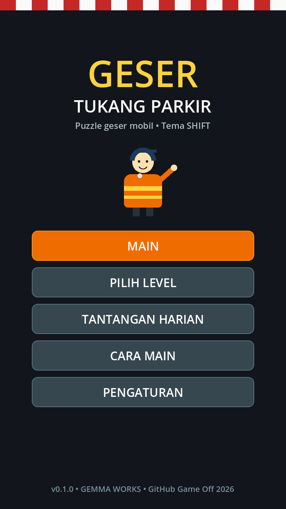
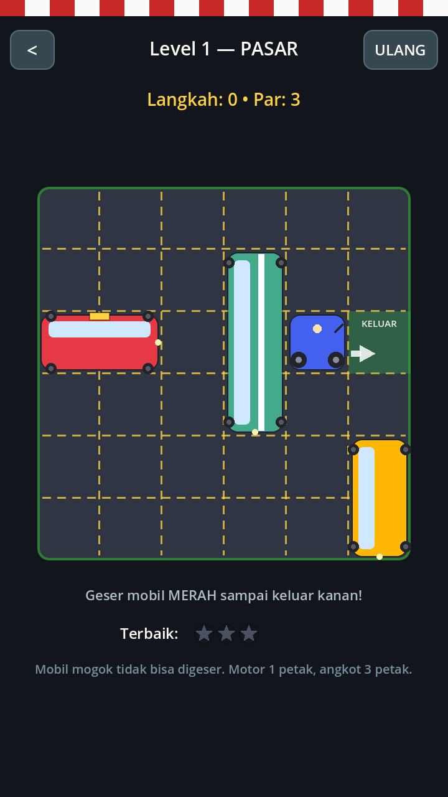
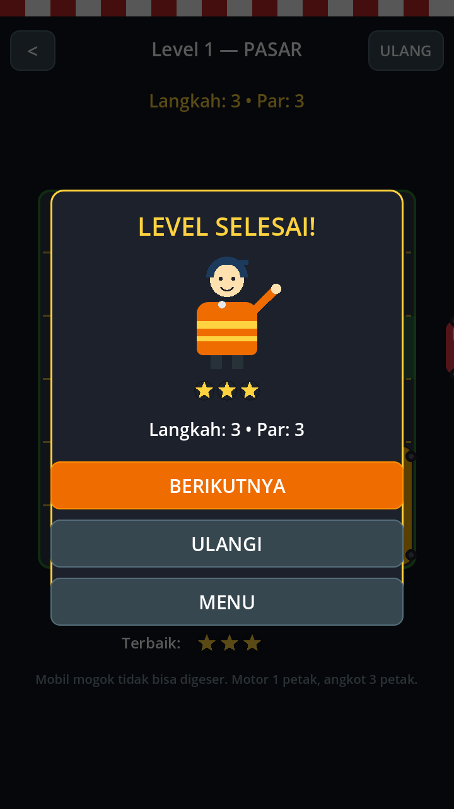

# Geser: Tukang Parkir

Puzzle geser mobil ala Rush Hour di parkiran pinggir jalan Indonesia.
Kamu adalah tukang parkir rompi oranye — geser mobil, motor, dan angkot
supaya mobil merahmu bisa keluar dari parkiran.

Dibuat untuk **GitHub Game Off 2026** (tema: **SHIFT**) oleh **GEMMA WORKS**.





## Cara Main

- **Tujuan:** keluarkan mobil **MERAH** lewat jalur **KELUAR** di sisi kanan
  papan (baris tengah).
- **Kontrol:** seret (drag) kendaraan dengan jari / mouse **searah sumbunya**
  saja — mobil horizontal hanya geser kiri-kanan, mobil vertikal hanya
  geser atas-bawah. Lepas untuk snap ke petak.
- **1 langkah** = satu kali seret yang mengubah posisi kendaraan (jauh
  dekatnya tidak dihitung, yang penting sekali geser).
- **Bintang:** ★★★ kalau langkahmu ≤ par, ★★ kalau ≤ par+4, ★ kalau lebih.
- **Motor** menempati 1 petak, **mobil** 2 petak, **angkot** 3 petak.
  **Mobil mogok** tidak bisa digeser — jadi rintangan statis (ketuk dia
  dan dia bergoyang kesal).
- Buka level berikutnya dengan menyelesaikan level sebelumnya.
  Progres (level terbuka + bintang) tersimpan otomatis.

## Menu

- **MAIN** — lanjut ke level terakhir yang terbuka
- **PILIH LEVEL** — pilih level per tema (Pasar / Terminal / Mal)
- **TANTANGAN HARIAN** — satu level acak setiap hari (berdasarkan tanggal)
- **CARA MAIN** — panduan singkat
- **PENGATURAN** — suara hidup/mati

## Level

30 level, 3 tema lokasi — tiap tema 10 level, kendaraan makin banyak.

| Level | Tema | Kendaraan | Par |
|------:|------|----------:|----:|
| 1 | Pasar | 4 | 3 |
| 2 | Pasar | 4 | 4 |
| 3 | Pasar | 5 | 6 |
| 4 | Pasar | 5 | 5 |
| 5 | Pasar | 5 | 6 |
| 6 | Pasar | 6 | 9 |
| 7 | Pasar | 6 | 10 |
| 8 | Pasar | 6 | 12 |
| 9 | Pasar | 6 | 9 |
| 10 | Pasar | 6 | 12 |
| 11 | Terminal | 6 | 10 |
| 12 | Terminal | 7 | 4 |
| 13 | Terminal | 7 | 3 |
| 14 | Terminal | 7 | 4 |
| 15 | Terminal | 8 | 4 |
| 16 | Terminal | 8 | 4 |
| 17 | Terminal | 8 | 4 |
| 18 | Terminal | 8 | 4 |
| 19 | Terminal | 8 | 4 |
| 20 | Terminal | 8 | 3 |
| 21 | Mal | 8 | 4 |
| 22 | Mal | 8 | 4 |
| 23 | Mal | 9 | 4 |
| 24 | Mal | 9 | 4 |
| 25 | Mal | 9 | 4 |
| 26 | Mal | 9 | 5 |
| 27 | Mal | 10 | 6 |
| 28 | Mal | 10 | 6 |
| 29 | Mal | 10 | 5 |
| 30 | Mal | 10 | 7 |

**Par = jumlah langkah optimal menurut solver BFS** (`solver.py`):
setiap level terbukti bisa diselesaikan, dan par-nya adalah jumlah langkah
tersingkat yang mungkin. Catatan jujur: di grid 6×6, solusi optimal
level-level padat mentok di kisaran 3–7 langkah — tantangannya adalah
*menemukan* solusi singkat itu di antara 8–10 kendaraan, bukan panjangnya.
Jalankan sendiri buktinya:

```sh
python3 solver.py --check levels.json   # harus berakhir "ALL OK"
```

## Menjalankan

- **Web (HTML5):** buka `web/index.html` lewat server HTTP apa saja
  (mis. `python3 -m http.server --directory web`), lalu buka di browser HP
  / desktop. Export Godot 4.3, tanpa thread (single-threaded).
- **Desktop (Godot 4.3):**
  ```sh
  godot --path .            # main menu
  godot --path . -- --autodrive   # mainkan solusi Level 1 otomatis (tes)
  godot --path . -- --showlevel  # buka Level 1 langsung (tes)
  ```
- **Android:** export preset tersedia di `export_presets.cfg`
  (bukan target utama jam ini).

## Teknologi

- Godot 4.3, GL Compatibility, portrait 720×1280 (HP-first, stretch
  canvas_items/expand).
- Semua visual digambar dari kode (GDScript `draw_*`, `StyleBoxFlat`) —
  **tanpa aset gambar / audio berlisensi dari luar**.
- Efek suara dibuat dari kode (`AudioStreamWAV` prosedural: klik, geser,
  menang) — tanpa file audio eksternal.
- Save memakai `ConfigFile` (`user://save.cfg`): level terbuka, bintang
  per level, pengaturan suara.
- Level dimuat dari `levels.json` saat runtime (`scripts/levels.gd`).

## Struktur file

```
project.godot          konfigurasi Godot 4.3
main.tscn              scene utama (Control root)
icon.svg               ikon (digambar kode)
export_presets.cfg     preset export Web (+Android)
levels.json            30 level + par + solusi (BFS-optimal)
solver.py              solver BFS + verifier level (--check)
build_levels.py        generator level (random + filter BFS)
fix_par.py             set par = BFS-optimal untuk semua level
scripts/
  main.gd              layar + alur (splash/menu/level/game/menang)
  board.gd             grid 6x6, batas geser, menang
  vehicle.gd           drag + gambar kendaraan
  levels.gd            muat levels.json
  save.gd              simpan progres
  sfx.gd               suara prosedural
  mascot.gd            tukang parkir (rompi oranye)
  star_row.gd          gambar bintang
shots/                 bukti screenshot (desktop + web)
web/                   hasil export HTML5
```

## AI Disclosure (wajib Game Off)

Game ini dibuat dengan **bantuan AI — Muse (Muse Spark)** — oleh
**GEMMA WORKS**: AI menulis kode GDScript + Python (game, solver,
generator level), merancang level (difilter + diverifikasi solver BFS),
dan menguji build. Semua aset visual dan suara dibuat dari kode
(prosedural), tanpa gambar hasil AI generatif di dalam game.
Keputusan desain, tema, dan arah game ditentukan manusia (Adi, GEMMA WORKS).

## Lisensi

Kode dan level game ini © 2026 GEMMA WORKS. Dibagikan sebagai entri
Game Off 2026; lihat repo untuk ketentuan penggunaan lebih lanjut.
